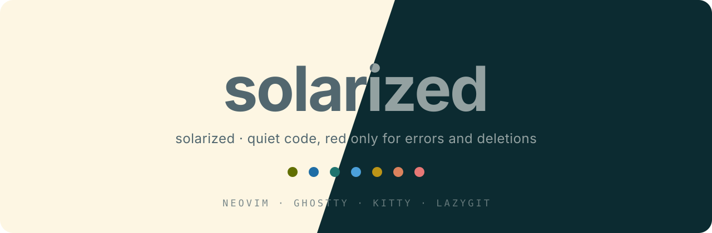
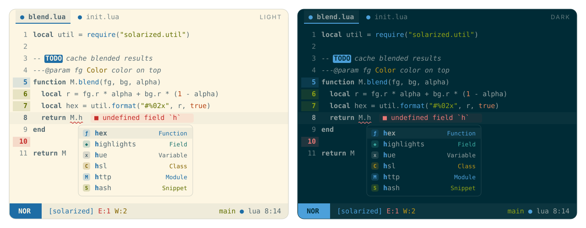

<p align="center">
  
</p>

<p align="center">
  <b>Solarized, quieted down.</b><br>
  Solarized backgrounds, four hues for code, red only for errors and deletions.
</p>

<p align="center">
  
</p>

## Philosophy

A personal take on [Solarized](https://github.com/maxmx03/solarized.nvim),
following the architecture and highlighting rules of
[onemono.nvim](https://github.com/amonteirom96/onemono.nvim).

The warm light background (`#fdf6e3`) comes from Solarized; the dark background
(`#182b2c`) softens its blue tint into a muted green-gray. Foregrounds and accents are adjusted for
readability: all four syntax accents pass WCAG AA (4.5:1) against both the
background and `surface2`. Comments pass AA against the background.

| Code | Appearance |
| --- | --- |
| Keywords | Foreground, bold |
| Variables, properties, modules, operators | Foreground |
| Comments | Dimmer foreground, italic |
| Strings | Green |
| Functions and methods | Blue |
| Types, classes, constructors | Yellow |
| Constants, numbers, booleans, null | Orange |

**Red is reserved for errors and deletions.** This includes diagnostics,
error messages, spelling errors, `FIXME` / `BUG` markers and removed lines.
The Visual mode statusline block is cyan. File icons and completion kinds
never use red. Purple and pink are omitted; ANSI magenta maps to blue.
The standard red ANSI slots remain available to terminal applications.

Git uses green for additions, blue for changes and red for deletions.
Diagnostics use red for errors, yellow for warnings, blue for information,
cyan for hints and green for success. Set `mono = true` for monochrome code.
Custom color/highlight callbacks can override these defaults.

## Installation

Requires **Neovim 0.10+**. With [lazy.nvim](https://github.com/folke/lazy.nvim):

```lua
{
  "amonteirom96/solarized.nvim",
  lazy = false,
  priority = 1000,
  opts = {},
  config = function(_, opts)
    vim.opt.termguicolors = true
    require("solarized").setup(opts)
    vim.cmd.colorscheme("solarized")
  end,
}
```

Replace the original `maxmx03/solarized.nvim` plugin entry with this one;
both provide the `solarized` Lua module and colorscheme name.
No build step is needed. Calling `setup()` is optional.

| Colorscheme | Behavior |
| --- | --- |
| `solarized` | Follows `'background'`, or `variant` when configured |
| `solarized-light` | Always light |
| `solarized-dark` | Always dark |

This theme uses the onemono configuration API. Options from the original
maxmx03 theme, such as `palette`, `plugins` and seasonal variants, do not apply.

## Configuration

```lua
require("solarized").setup({
  variant = "auto", -- "auto" | "light" | "dark"
  transparent = false,
  terminal_colors = true,
  dim_inactive = false,
  muted_comments = false,
  mono = false,
  float = { solid = false },
  styles = {
    comments = { italic = true },
    keywords = { bold = true },
    functions = {},
    variables = {},
    strings = {},
    types = {},
    constants = {},
    operators = {},
  },
  integrations = {
    blink = true,
    dropbar = true,
    gitsigns = true,
    grug_far = true,
    lazy = true,
    mason = true,
    mini = true,
    semantic_tokens = true,
    statusline = true,
    treesitter = true,
  },
  cache = true,
  -- on_colors = function(colors, variant) end,
  -- on_highlights = function(highlights, colors, variant) end,
})
```

For monochrome code without bold or italic:

```lua
require("solarized").setup({
  mono = true,
  styles = { comments = {}, keywords = {} },
})
```

Access or customize the same palette used by the integrations:

```lua
local colors = require("solarized").colors("dark")
local highlights = require("solarized").highlights("light")

require("solarized").setup({
  on_colors = function(c)
    c.code.func = c.cyan
  end,
  on_highlights = function(hl, c)
    hl.StProject = { fg = c.blue, bg = c.surface2 }
  end,
})
```

See [`:help solarized`](doc/solarized.txt) for the full API.

## Integrations and cache

Includes Treesitter captures, LSP semantic tokens, blink.cmp completion kinds,
dropbar symbols, gitsigns, mini.icons, mini.pick / mini.extra, mini.files,
mini.tabline, grug-far, lazy.nvim, mason.nvim and custom `St*` statusline groups.
Each integration can be disabled through `integrations`.

Highlights compile to LuaJIT bytecode with integer colors, following onemono's
compiler. The cache is separate from onemono and keyed by this theme's version
and configuration. Updates and option changes rebuild it automatically.

| Command | Action |
| --- | --- |
| `:SolarizedCompile` | Rebuild cache and reload the active theme |
| `:SolarizedClearCache` | Delete the theme cache |
| `:SolarizedExtras [dir]` | Generate terminal and Lazygit themes |

Run `:SolarizedCompile` after changing values captured by an `on_colors` or
`on_highlights` closure. Set `cache = false` while editing the theme.

## Extras

Generated from the same palette, including customizations when regenerated:

| Tool | Files | Setup |
| --- | --- | --- |
| Ghostty | `extras/ghostty/solarized-{light,dark}` | Copy to `~/.config/ghostty/themes/`; set `theme = light:solarized-light,dark:solarized-dark` |
| Kitty | `extras/kitty/solarized-{light,dark}.conf` | Include the desired file, or copy to `light-theme.auto.conf` / `dark-theme.auto.conf` |
| Lazygit | `extras/lazygit/solarized-{light,dark}.yml` | Append the file path to `LG_CONFIG_FILE` |

Lazygit diff colors follow the terminal ANSI palette. Unstaged changes use
blue; red is kept for deletions. Terminal applications control their own use
of ANSI colors.

## Development

```sh
nvim --headless -u NONE -i NONE --cmd 'set rtp^=.' -l tests/smoke.lua
nvim --headless -u NONE -i NONE --cmd 'set rtp^=.' -l scripts/contrast.lua
nvim --headless -u NONE -i NONE --cmd 'set rtp^=.' -l scripts/bench.lua
nvim --headless -u NONE -i NONE --cmd 'set rtp^=.' -c "lua require('solarized').extras()" -c q
nvim --headless -u NONE -i NONE --cmd 'set rtp^=.' -l scripts/assets.lua
```

Bump `M.version` in `lua/solarized/init.lua` after changing theme definitions
to invalidate compiled caches. README images are generated SVG editor mockups.

## Credits and license

Solarized palette by [Ethan Schoonover](https://ethanschoonover.com/solarized/),
with [maxmx03/solarized.nvim](https://github.com/maxmx03/solarized.nvim) as the
visual reference. Implementation adapted from
[Arthur Monteiro's onemono.nvim](https://github.com/amonteirom96/onemono.nvim).

[MIT](LICENSE).
